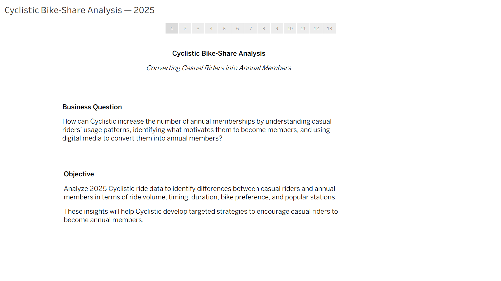
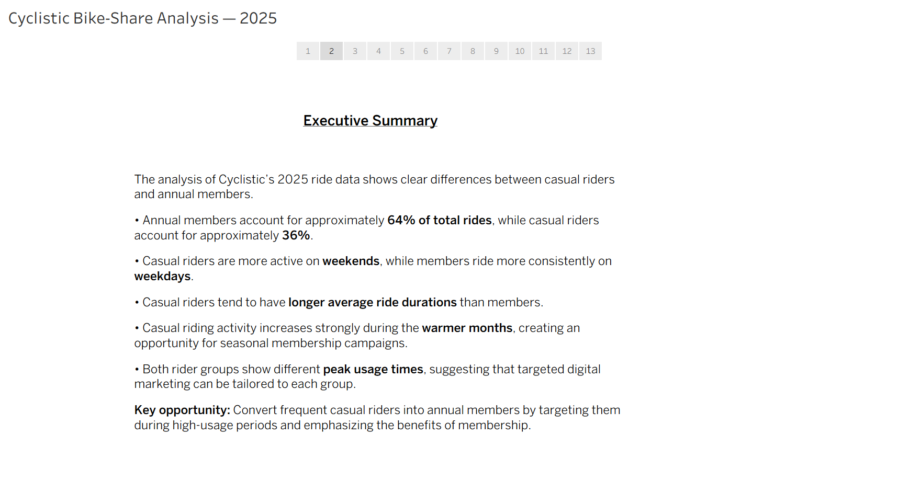
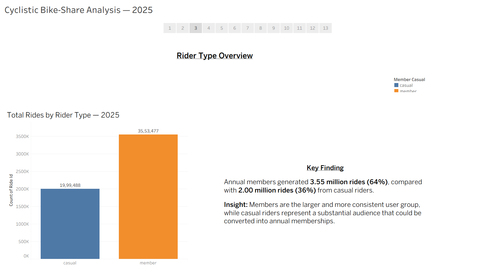
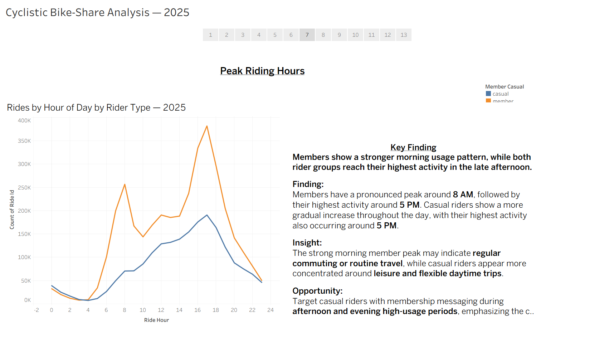
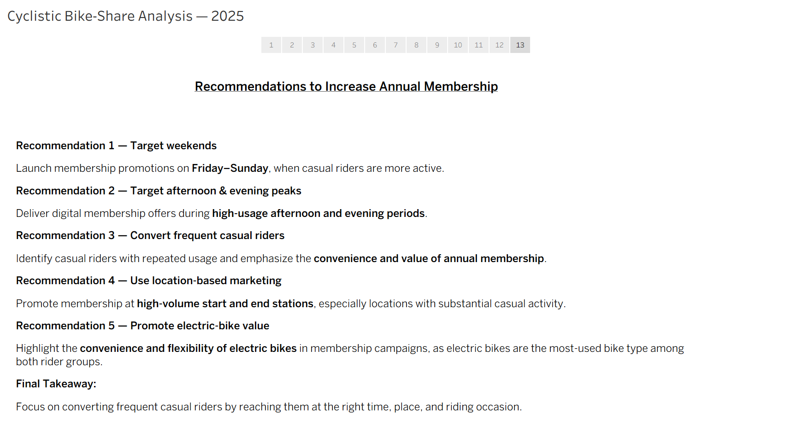

# Cyclistic Bike-Share Analysis — 2025

## 📌 Project Overview

This project analyzes 2025 Cyclistic bike-share data to understand how **casual riders and annual members use the service differently**.

The analysis focuses on identifying behavioral patterns and opportunities that can help Cyclistic convert more casual riders into annual members.

## 📊 Tableau Public

[View the interactive Tableau Story — Cyclistic Bike-Share Analysis 2025](https://public.tableau.com/shared/CRS5Q8WRT?:display_count=n&:origin=viz_share_link)

---

## 🎯 Business Task

Cyclistic wants to increase the number of annual memberships.

The key business question is:

> How do casual riders and annual members use Cyclistic bikes differently, and how can these differences be used to encourage casual riders to become annual members?

---

## 🖼️ Project Preview

### Business Question

### Executive Summary

### Monthly Ride Trends

### Peak Riding Hours

### Recommendations

[View all 13 Tableau Story screenshots](tableau/screenshots/)

---

## 🗂️ Dataset

The analysis uses Cyclistic bike-share trip data covering **January–December 2025**.

The dataset contains information including:

- Ride ID
- Bike type
- Start and end times
- Start and end stations
- Start and end locations
- Rider type (casual or member)

After data cleaning, the analysis contains approximately **5.55 million rides**.

---

## 🛠️ Tools Used

- **SQL / SQLite** — Data cleaning and analysis
- **Tableau** — Data visualization and storytelling
- **Excel / Google Sheets** — Supporting data preparation and analysis
- **GitHub** — Project documentation and portfolio

---

## 🧹 Data Preparation

The data was cleaned and prepared before analysis.

Key steps included:

- Combining monthly 2025 datasets
- Removing records with missing station information
- Removing records with missing rider type or bike type
- Removing rides with invalid or non-positive durations
- Creating calculated fields for:
  - Ride duration
  - Ride hour
  - Month
  - Day of week
  - Rider type

---

## 📊 Analysis

The analysis examined differences between casual riders and annual members across several dimensions:

### Rider Type

Annual members represent the majority of Cyclistic rides, while casual riders account for a substantial share of total usage.

### Monthly Trends

Casual riding increases substantially during the warmer months, while member usage remains consistently strong throughout the year.

### Day of Week

Casual riders show stronger activity during weekends, while members have stronger weekday usage.

### Ride Time

Members show stronger activity around typical commuting periods, particularly morning and evening hours.

Casual riders show stronger activity during later morning, afternoon, and evening periods.

### Bike Type

Electric bikes are the preferred bike type for both casual riders and annual members.

### Start & End Stations

A relatively small number of stations account for a significant amount of rider activity.

These high-volume locations provide opportunities for targeted membership marketing.

### Ride Duration

Casual riders generally have longer average ride durations than annual members across the year.

---

## 🔍 Key Findings

1. **Casual riders are more active on weekends**, while members have stronger weekday usage.

2. **Casual riders are more active during afternoon and evening periods**, creating opportunities for time-targeted marketing.

3. **Electric bikes are highly popular among both rider groups**, suggesting that electric-bike usage can be incorporated into membership campaigns.

4. **High-volume stations concentrate a significant amount of rider activity**, creating opportunities for location-based promotions.

5. **Casual riders tend to have longer average ride durations**, indicating stronger recreational or leisure-oriented usage.

6. **Casual riding increases significantly during warmer months**, suggesting seasonal opportunities for membership campaigns.

---

## 💡 Recommendations

### 1. Target Casual Riders on Weekends

Launch membership promotions from **Friday through Sunday**, when casual rider activity is higher.

### 2. Target Afternoon & Evening Peaks

Use digital membership promotions during **high-usage afternoon and evening periods** when casual riders are already actively using Cyclistic.

### 3. Convert Frequent Casual Riders

Identify casual riders with repeated usage and communicate the **convenience and value of annual membership**.

### 4. Use Location-Based Marketing

Promote membership at **high-volume start and end stations**, particularly locations with substantial casual activity.

### 5. Promote Electric-Bike Value

Highlight the **convenience and flexibility of electric bikes** in membership campaigns because electric bikes are popular with both rider groups.

---

## 📈 Tableau Analysis

The project includes a Tableau story covering:

- Rides by Rider Type
- Monthly Ride Trends
- Casual Rider Percentage
- Average Ride Duration
- Weekday vs Weekend Rides
- Rides by Hour
- Top 10 Start Stations
- Top 10 End Stations
- Bike Type Preference
- Average Ride Duration by Month
- Rides by Day of Week
- Final Recommendations

---

## 📌 Final Business Recommendation

Cyclistic should focus on converting **frequent casual riders into annual members** by reaching them at the right **time, place, and riding occasion**.

The strongest opportunities are:

**Weekend usage + afternoon/evening peaks + high-volume stations + electric-bike usage**

These insights can be used to create targeted digital and location-based membership campaigns.

---

## 🧠 Skills Demonstrated

- Data cleaning
- SQL
- Exploratory data analysis
- Data visualization
- Tableau
- Business analysis
- Data storytelling
- Insight generation
- Business recommendations
- GitHub documentation

---

## 👤 Author

**Raja**

Data Analytics Portfolio Project
